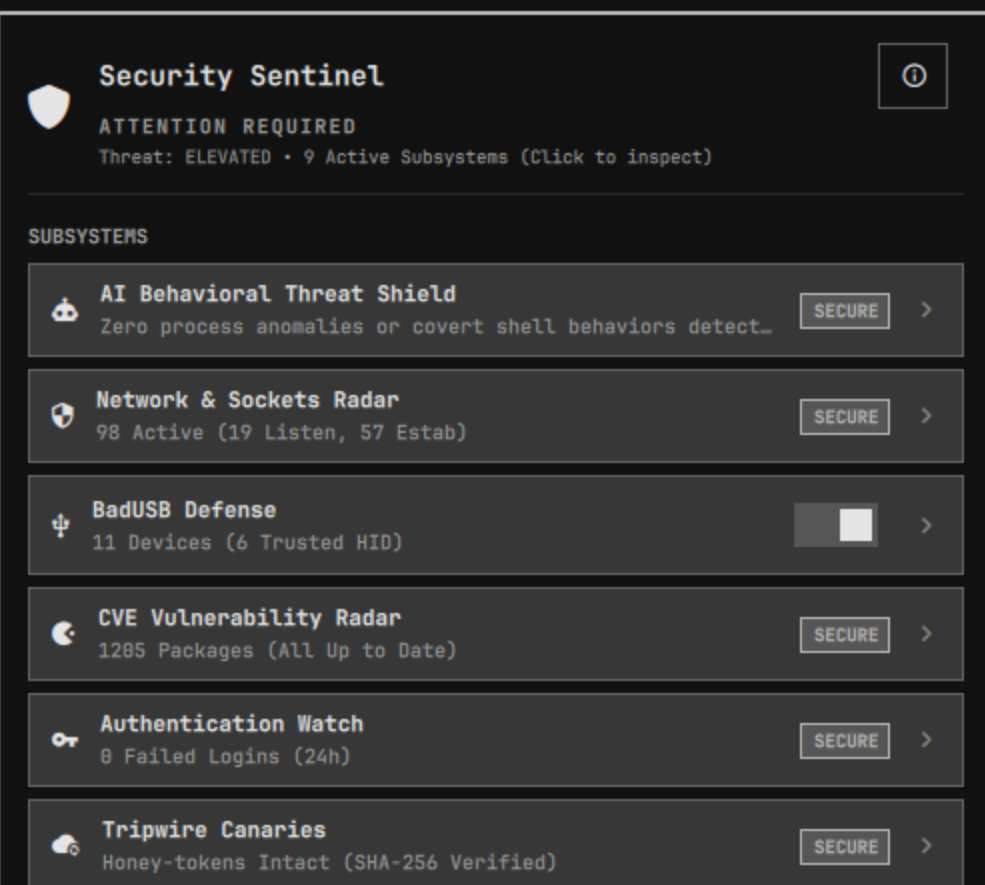

# Security Sentinel Hub - Omarchy Linux İçin Bütünleşik Siber Savunma ve Gizlilik Merkezi

[](https://github.com/omacom/omarchy-plugin-marketplace/issues/9531)
[](https://github.com/ozdil/omarchy-security-sentinel/releases)
[](https://github.com/ozdil/omarchy-security-sentinel/actions/workflows/rust.yml)
[](https://buymeacoffee.com/ozdil)



Omarchy Linux için hepsi bir arada yerel siber savunma, donanım bütünlüğü denetçisi ve gizlilik koruma eklentisi.

Geliştirici: Ozan Özdil (ozdil)  
Lisans: MIT  
Eklenti Kimliği: ozdil.security-sentinel  
Sürüm: 1.5.0 ([değişiklik günlüğü](CHANGELOG.md))

---

## Genel Bakış

Security Sentinel Hub, 9 Linux savunma ve gizlilik alt sistemini tek bir yüksek başarımlı yerel Rust servisinde (`sentinel-engine`) ve temayla uyumlu Quickshell arayüzünde birleştirir.
HANCORE Kurumsal Askeri Güvenlik Standartları, çekirdek seviyesinde sıfır güven politikaları, sınırlandırılmış IPC süreçleri ve gerçek zamanlı donanım bütünlüğü doğrulaması sunar.

---

## 1.5.0 ile Gelenler

İkinci kapsamlı analizden çıkan düzeltmeler (tam liste: [CHANGELOG.md](CHANGELOG.md)):

- `arch-audit` önem dereceleri doğru okunuyor; düzeltmesi olan kritik açık yeniden alarm üretiyor.
- Silinen tuzak dosyası (canary) sessizce yeniden oluşturulmuyor, alarm veriyor.
- USB Armor, BadUSB cihazının kapatabileceği bir şifre penceresi açmadan engelliyor; başarısız engelleme tekrar deneniyor ve bildiriliyor.
- Panel hata durumunda güvenli varsaymıyor: motor yoksa veya bozuksa "ENGINE OFFLINE" gösteriyor, asla "ALL SYSTEMS SECURE" değil.
- Başarısız işlemler motorun gerekçesini gösteriyor; Dondur/Sonlandır, raporda görülen sürece sabitleniyor.
- OpSec temizleyici progresif JPEG'leri de temizliyor ve görüntü sonrasındaki verileri (telefon MPF görüntüleri, ekler) atıyor.
- Paket, Omarchy'nin gerçekten bulduğu bir eklenti kuruyor (bkz. Kurulum).

### 1.4.0

Kapsamlı bir güvenlik denetiminden çıkan sürüm. Öne çıkanlar (tam liste: [CHANGELOG.md](CHANGELOG.md)):

- Olay tabanlı arka plan servisi: takılan USB cihazı 20 sn beklemeden, bir saniye içinde denetlenir.
- BadUSB parmak izi seri numarası ve arayüz sınıflarını da içerir; VID:PID kopyalayıp klavye ekleyen cihaz yakalanır.
- `arch-audit` ile Arch Security Tracker'dan gerçek CVE verisi.
- Her soket süreç adı ve PID ile gösterilir; soket anomali analizi artık çalışıyor.
- Yetki gerektiren işlemler paketle gelen polkit politikasından geçer; süreçlere pidfd ile sinyal gönderilir.
- "Trust Devices" sonrası USB Armor artık kendi klavye ve farenizi kilitlemiyor.
- Başarısız anahtarlar geri alınır; yıkıcı işlemler ikinci tıklamayla onaylanır.
- Daha sade, düz Omarchy tarzı panel ve gösterge paneli.

---

## Alt Sistemler ve Yetenekler

1. Ağ ve Soket Radarı: Gerçek zamanlı soket izleme (`/proc/net/tcp*`, `/proc/net/udp*`), her soketin süreç adı ve PID'i, şüpheli port tespiti. Okunamayan bir tablo "temiz" değil uyarı olarak raporlanır.
2. BadUSB Koruması & Donanım Zırhı: Yerel cihaz parmak izi listesi (`trusted_usb.json`, 0600 izinli: VID:PID, seri numarası ve arayüz sınıfları). Güvenilir bir kimliği kopyalayıp klavye arayüzü ekleyen cihaz, takıldığı anda kernel uevent ile yakalanır (arka plan servisi `sentinel-engine --daemon` panel tarafından başlatılır). USB Armor güvenilmeyen cihazı şifre sormadan engeller; hub'lar hiçbir zaman engellenmez.
3. CVE Zafiyet Radarı: Kurulu paketleri `arch-audit` ile Arch Security Tracker'a karşı eşleştirir (CVE kimliği, önem derecesi, düzeltilmiş sürüm; 6 saat önbellekli) ve `checkupdates` (pacman-contrib) ile bekleyen güncellemeleri listeler. Düzeltmesi yayımlanmış kritik bir açık alarm üretir.
4. Kimlik Doğrulama Nöbetçisi: Systemd journald ve PAM üzerinden son 24 saatteki başarısız giriş ve SSH denemeleri. Sistem günlüğünü görmek için kullanıcının `systemd-journal`, `wheel` veya `adm` grubunda olması gerekir; görünmüyorsa uyarı verilir.
5. Tuzak Dosyalar (Tripwire Canaries): Fidye yazılımlarına karşı SHA-256 mühürlü bal küpü dosyaları. Değiştirilen veya silinen tuzak dosyası alarm üretir; yalnızca "Reset canaries" yeniden oluşturur.
6. DNS Sızıntı Kalkanı (DoT): `omarchy-dns` ile Cloudflare DNS-over-TLS (1.1.1.1, systemd-resolved'da opportunistic kip). `omarchy dns Custom` ile ayarlanmış özel çözümleyici olduğu gibi gösterilir ve üzerine yazılmaz.
7. Hayalet MAC (Wi-Fi Rastgeleleştirici): NetworkManager (`nmcli`) ile bağlantı başına rastgele MAC adresi.
8. Süreç Davranış Sezgileri ("AI Behavioral Threat Shield"): Her süreç için kural tabanlı puanlama: `/tmp` gibi yazılabilir yollardan çalışma, ters kabuk ve madenci komut satırı imzaları, yüksek entropili argümanlar ve 64 KiB'yi aşan (dolgulu) komut satırları. Makine öğrenmesi modeli yoktur; puan ve gerekçeleri süreç başına gösterilir.
9. OpSec Meta Veri Temizleyici: JPEG ve PNG dosyalarından EXIF/meta veriyi kayıpsız siler (progresif JPEG'lerin her taraması dahil; görüntü sonundan sonraki veriler atılır). Panele sürükle-bırak, dosya seçici ve İndirilenler klasörünü toplu temizleme.

---

## Gereksinimler

- cargo ve rustc (kaynaktan derleme için)
- quickshell, polkit, libnotify, networkmanager, systemd, nftables, iproute2
- İsteğe bağlı: arch-audit (CVE verisi), pacman-contrib (`checkupdates`), zenity (dosya seçici)

---

## Kurulum ve Derleme

```bash
omarchy plugin add https://github.com/ozdil/omarchy-security-sentinel.git
cd ~/.config/omarchy/plugins/ozdil.security-sentinel
cargo build --release --locked
install -m 755 target/release/sentinel-engine ./sentinel-engine
```

Başkasına ait süreçlere müdahale, USB engelleme ve ağ karartması için root'a ait motor ve polkit politikası gerekir (paket ikisini de kurar). Kaynaktan kurulumda:

```bash
sudo install -Dm755 target/release/sentinel-engine /usr/bin/sentinel-engine
sudo install -Dm644 assets/io.omarchy.sentinel.policy /usr/share/polkit-1/actions/io.omarchy.sentinel.policy
```

Bunlar olmadan izleme çalışır; bu işlemler ise genel bir `pkexec kill` yerine açıklamalı bir hatayla reddedilir.

Arch paketi: `makepkg -si` motoru, polkit politikasını ve eklentiyi `/usr/share/omarchy-security-sentinel` altına kurar. Omarchy eklentileri yalnızca kullanıcı yapılandırmasından yüklediği için bir kez bağlayın:

```bash
ln -s /usr/share/omarchy-security-sentinel ~/.config/omarchy/plugins/ozdil.security-sentinel
omarchy plugin enable ozdil.security-sentinel
```

---

## Doğrulama ve Testler

```bash
# Birim ve çekirdek testlerini çalıştırın
cargo test

# Omarchy eklenti doğrulamasını çalıştırın
omarchy plugin validate .
```
